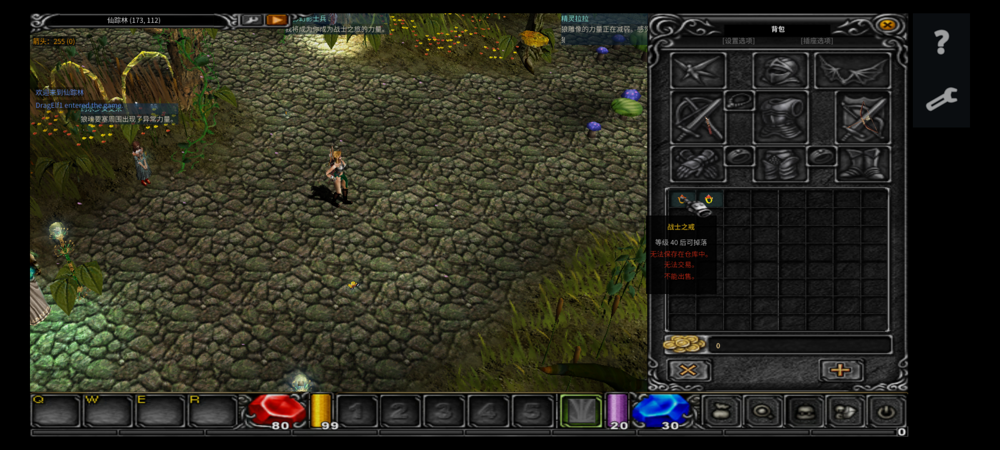
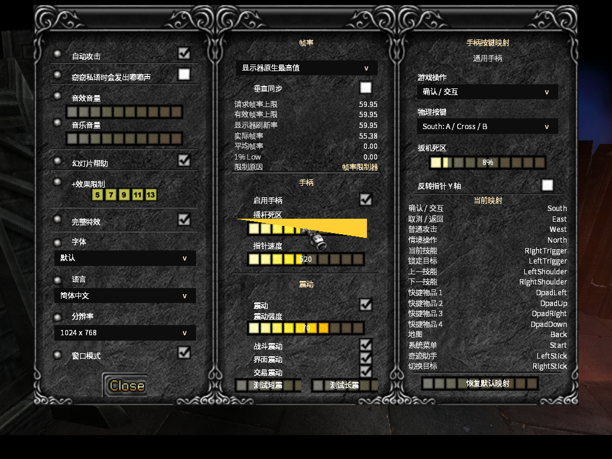
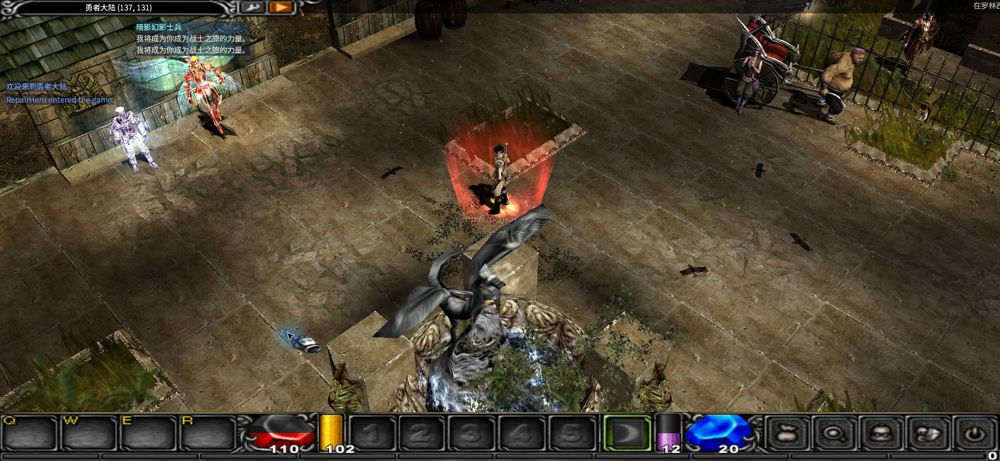
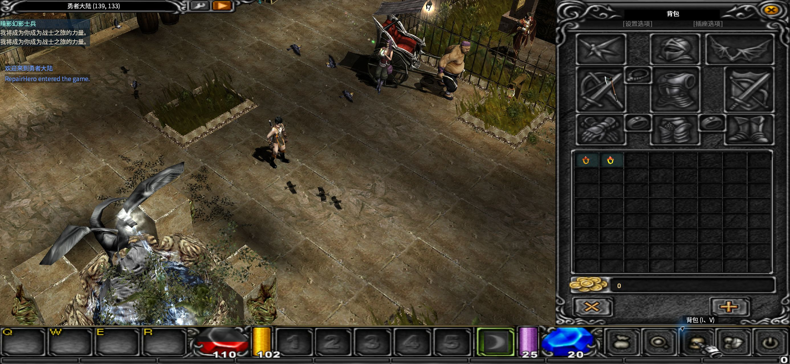

# OpenMU (Open Multi-Platform Universe)

**High-Performance, Cross-Platform 3D Isometric World Engine & Distributed Runtime**

A clean-room systems engineering initiative modernizing classic isometric virtual world architectures with native cross-device execution: Windows · Android · HarmonyOS · iOS · macOS · Linux.


*Native cross-device execution: Android / HarmonyOS mobile client featuring custom dual-zone touch gesture HUD, contextual actions, and dynamic safe-area adaptation.*

[](LICENSE)
[](https://github.com/MUnique/OpenMU)
[](https://github.com/sven-n/MuMain)
[](#supported-platforms--cross-device-portability)
[](#unified-input-abstraction-touch--gamepad-first)
[](#architecture)
[](#architecture)
[-d69e2e?style=flat-square)](#localization-pipeline)
[](#verification--test-infrastructure)

---

## Why this project exists

Early-2000s isometric MMORPG architectures suffered from fundamental legacy constraints: single-threaded Win32 message loops, ANSI-only code pages, fixed-function OpenGL 1.1 graphics pipelines, hardcoded 4:3 resolutions, and direct coupling to keyboard/mouse desktop environments.

**OpenMU Engine** re-architects the entire client-server stack into a modern, cross-device, open-source ecosystem:
- **Modern Core Profile Graphics**: A modernized renderer built on **OpenGL 3.3 Core Profile** (with mobile GLES / gl4es support), replacing deprecated fixed-function pipelines with ring-buffered Uniform Buffer Object (UBO) streaming and geometry instancing.
- **Unified Cross-Device Input**: An abstraction layer spanning modern gamepads, custom multi-touch gesture engines, and traditional keyboard/mouse setups.
- **Native AOT Network Runtime**: A high-concurrency client networking library powered by **.NET 10 Native AOT**, delivering compiled ARM64 and x86_64 machine code with zero GC latency on critical network paths.
- **End-to-End Unicode Architecture**: Complete internal migration to UTF-16LE with UTF-8 boundary serialization, enabling seamless runtime locale switching across 15 languages.
- **Extreme Portability**: Fully native build paths targeting **six operating systems** across desktop, mobile, and emerging environments.

---

## Highlights

### Supported Platforms & Cross-Device Portability

The engine compiles natively across six distinct platforms without relying on heavy web-views or emulators:

| Platform | Target Architecture | Build System & Implementation Details | Maturity |
| :--- | :--- | :--- | :--- |
| **Windows** | x86 / x64 | CMake + Ninja, MSBuild presets, Clang-Tidy & AddressSanitizer (ASan) integration | Production Ready |
| **Android** | ARM64 (`aarch64`) | Android NDK, CMake native pipeline, GLES/gl4es acceleration, Native AOT arm64 runtime, Gradle packaging | Production Ready |
| **HarmonyOS** | ARM64 (`aarch64`) | OpenHarmony / HarmonyOS native hvigor modules (`harmony-game`, `harmony-gm`, `harmony-pc`) and `nativeaot-ohos` | Production Ready |
| **iOS** | ARM64 (`arm64`) | Xcode / CMake native target (`game-ios`), iOS Native AOT client library runtime (`nativeaot-ios`) | Ported / Functional |
| **macOS** | Universal (`arm64` + `x86_64`) | Objective-C++ bridge integrated at CMake level, Apple Silicon and Intel universal binaries | Functional |
| **Linux** | x64 / ARM64 | MinGW-w64 cross-compile toolchains, native GCC/Clang builds with headless server support | Functional |

---

### Unified Input Abstraction: Touch & Gamepad First

Input is handled through a unified hardware-agnostic layer (`GamepadService`, `SdlGamepadBackend`, `GamepadMapper`, `GamepadBindings`, and `FocusNavigator`), ensuring identical gameplay fluidity across phone touchscreens, handheld consoles, and desktop rigs.

#### 1. Console-Grade Gamepad Engine
- **Hardware Agnostic**: Full dynamic button remapping with persistent configurations and one-click reset to defaults.
- **Precision Analog Tuning**: Configurable deadzones, dynamic cursor acceleration, and Y-axis inversion.
- **5-Channel Haptic Rumble**: Independent vibration channels for combat impact, ambient UI cues, trade interactions, and master intensity tuning with live diagnostic test triggers.
- **Focus Navigator**: Graph-based UI focus traversal enabling complex inventories, dialog trees, and character screens to be navigated purely via D-pad and analog sticks.
- **Virtual On-Screen Keyboard**: Integrated pad-controlled typing interface for text entry in controller-only environments.


*Gamepad configuration: Dynamic button binding, deadzone calibration, cursor velocity curves, and multi-channel haptic feedback.*

#### 2. Native Mobile Touch Gesture Layer
The mobile client uses a purpose-built multi-touch gesture engine rather than a crude virtual mouse:
- **Dual-Zone Interaction**: Left-screen continuous drag for character vector navigation; right-screen discrete tap for entity targeting and context actions.
- **Combat Gestures**: Double-tap skill quadrant to cast primary abilities; two-finger horizontal swipe to cycle skill decks.
- **Camera & Navigation**: Pinch-to-zoom, two-finger vertical drag for pitch adjustment, three-finger swipe-up for full world map, and three-finger swipe-down for settings.
- **Accessibility & Ergonomics**: Full left-hand mode (inverting control quadrants and UI anchors without altering world-space projection coordinates), notch/safe-area clipping adaptation, and dynamic UI scale/opacity controls.


*Mobile client: Dual-zone gesture HUD, ergonomic side utility dock, and touch-optimized item inspection tooltips.*

---

### Modern Graphics & Low-Level Systems Optimization

- **Core Profile OpenGL Pipeline**: Replaced legacy display lists and immediate mode calls (`glBegin`/`glEnd`) with persistent ring-buffered UBO streaming, eliminating CPU-GPU pipeline stalls.
- **Texture-Pair Bucketing**: Geometry draw calls collapsed and batched by shared texture state, achieving a **~25× reduction in terrain draw calls**.
- **GPU Skeletal Skinning**: Character mesh transformations offloaded to vertex shaders with SIMD matrix math.
- **Parallel Animation Tick Pool**: Multi-threaded job system for skeletal animation updates in crowded entity hubs.
- **Hardware Benchmarks**: Measured frame-time improvements on target development hardware:
  - **Average FPS**: `+4.4%`
  - **1% Low FPS**: `+28.0%`
  - **Frame Time Deviation**: `−4.1%`

---

### Deterministic Simulation & Mathematical Balance Engine

Housed in `OpenMU-数值重设计/`, the engine features a standalone numerical laboratory (`BalanceLab`) with rigorous mathematical modeling and deterministic simulation:
- **Continuous Decimal Formulas**: Replaced legacy coarse integer truncations with smooth, continuous monotonic curves for attack speed, hit probability ($[0.05, 0.95]$ clamp), and buff scaling.
- **Hyperbolic Armor Mitigation**: Implemented continuous damage reduction ($Damage = Raw \times \frac{K}{Armor + K}$) eliminating artificial defense cliffs.
- **High-Precision Economy**: Decoupled drop economies with 4-decimal-place probability distribution tables and overflow-safe 64-bit currency math.
- **Progression Convergence**: Validated across 14 character build archetypes to achieve deterministic level-up progression targets within $\pm 10\%$ variance via automated Monte Carlo simulation runs.

---

### Localization Pipeline

The localization engine is built from the ground up for seamless international distribution:
- **Architecture**: In-memory UTF-16LE string representation with UTF-8 boundary encoding, completely removing legacy ANSI page locking.
- **Pipeline**: Automated `.resx` schema transformation to type-safe C++ compile-time accessors with runtime observer callbacks for instant language hot-reloading.
- **15 Supported Locales**: English, Simplified Chinese, Traditional Chinese, Japanese, Korean, German, Spanish, French, Portuguese, Russian, Ukrainian, Polish, Indonesian, Vietnamese, and Filipino.

---

## Screenshots & Multi-Platform Showcase

| Real-Time 3D World (Desktop) | Native Multi-Touch HUD (Mobile) |
| :---: | :---: |
|  |  |
| *Real-time 3D isometric rendering with dynamic lighting and camera projection* | *Dual-zone gesture controls, skill decks, and notch/safe-area adaptation* |
| **Console-Grade Gamepad Calibration** | **Equipment & Inventory Engine** |
|  |  |
| *5-channel haptic tuning, deadzone calibration, and focus navigation* | *Grid-based inventory system with server-side validation* |

---

## Architecture

```
┌────────────────────────────────────────────────────────────────────────┐
│  Client Application Tier                                               │
│    MuMain Engine        C++20 · SDL3 · OpenGL 3.3 Core Profile         │
│    Mobile App Shells    Android (NDK/Gradle) · HarmonyOS · iOS · macOS │
├────────────────────────────────────────────────────────────────────────┤
│  Unified Abstraction Layer                                             │
│    Input Core           GamepadService · FocusNavigator · TouchEngine  │
│    Localization         UTF-16LE Unicode · Dynamic 15-Language Engine  │
├────────────────────────────────────────────────────────────────────────┤
│  Network & Serialization Tier                                          │
│    High-Speed Runtime   C# / .NET 10 Native AOT Client Library (arm64) │
│    Protocol Engine      Zero-allocation packet serialization & crypto  │
├────────────────────────────────────────────────────────────────────────┤
│  Distributed Server Engine                                             │
│    GameLogic Core       State replication · Anti-cheat movement verify │
│    Numerical System     BalanceLab · Hyperbolic curves · Decimal drops │
│    Persistence          PostgreSQL high-concurrency storage engine     │
└────────────────────────────────────────────────────────────────────────┘
```

---

## Repository Layout

```
├── MuMain/                 # High-performance C++20 client engine (SDL3, OpenGL 3.3, unified input)
├── OpenMU/                 # Distributed .NET 10 modular game server, network stack & admin portal
├── OpenMU-Android/         # Android ARM64 native application shell, NDK build & Gradle pipeline
├── OpenMU-HarmonyOS/       # OpenHarmony / HarmonyOS native hvigor modules and build system
├── OpenMU-iOS/             # iOS native application target and Native AOT runtime scripts
├── OpenMU-数值重设计/       # BalanceLab: Deterministic numerical simulation, formulas & balance data
├── tests/                  # Multi-tier E2E test suites, adversarial stress tests & regression suites
├── loc/                    # Localization definitions (.resx) and automatic C++ code generators
└── assets/                 # Graphics, diagrams, and UI demonstration captures
```

---

## Verification & Test Infrastructure

The repository enforces strict code quality and behavioral correctness through a dual-track automated test suite:
- **Tier 1-4 Feature & Regression Tests** (`tests/e2e/`): 36+ automated verification suites covering client network packet dispatching, server movement and skill anti-cheat validation, transaction safety, dictionary adapter contracts, and thread safety.
- **Adversarial Stress Testing** (`tests/adversarial/`): Automated multi-round adversarial runners verifying combat formulas, continuous decimal curves, edge-case economy bounds, and memory safety.
- **In-Engine Unit Tests** (`OpenMU/tests/`): Full xUnit coverage across server state machines, network serializers, and database persistence layers.

To run the verification suite:
```powershell
python -m unittest discover -s tests/e2e/tier1_features -p "test_*.py"
```

---

## Building from Source

### Prerequisites
- **Client**: CMake 3.25+, C++20 compliant compiler (MSVC 2022, Clang 16+, or GCC 13+), and .NET 10 SDK (for Native AOT client library).
- **Server**: .NET 10 SDK and PostgreSQL 14+.

### Client Build (Windows x64)
```powershell
cmake --preset windows-x64
cmake --build --preset windows-x64-release
```

### Server Build (.NET 10)
```bash
dotnet build OpenMU/src/MUnique.OpenMU.sln -c Release
```

For detailed platform-specific compilation instructions, refer to:
- Desktop Client Build: [`MuMain/docs/build/`](MuMain/docs/build/)
- Server Quickstart: [`OpenMU/QuickStart.md`](OpenMU/QuickStart.md)
- Android Packaging: [`OpenMU-Android/Build-AndroidPackage.ps1`](OpenMU-Android/Build-AndroidPackage.ps1)

---

## Credits, Upstream Repositories & Open-Source Licensing

This project is an open-source systems programming research and cross-platform engineering initiative dedicated to high-performance virtual world architecture, modern graphics pipelines, and distributed simulation runtimes. It builds upon and gratefully acknowledges the foundational contributions of upstream open-source projects:

### Upstream Open-Source Repositories
- **Distributed Server Core**: **[MUnique/OpenMU](https://github.com/MUnique/OpenMU)** — High-concurrency C# / .NET distributed game server architecture, network protocol stack, and administration suite (licensed under the **[MIT License](https://github.com/MUnique/OpenMU/blob/master/LICENSE)**, Copyright © 2017 MUnique).
- **Client Foundation**: **[sven-n/MuMain](https://github.com/sven-n/MuMain)** — Open-source C++ client baseline, which provided the early technical foundation for Core Profile OpenGL modernization, frame timing stabilization, and localization infrastructure.

### Third-Party Libraries & Runtimes
All third-party dependencies retain their respective permissive licenses:
- **SDL3** (zlib License) — Unified cross-platform windowing and event dispatch
- **OpenGL / gl4es** (MIT License) — Core Profile and mobile hardware acceleration
- **Dear ImGui** (MIT License) — In-engine diagnostics and calibration HUD
- **libcurl** (curl License) — Network transport
- **librime** (BSD-3-Clause) — In-engine multi-lingual IME input
- **libjpeg-turbo** (IJG / BSD-3-Clause) — High-throughput image decoding

### Legal & Ethical Disclaimer
This repository contains clean-room engine and server source code published solely for systems programming research, human-computer interaction study, and open-source software preservation. It does not contain, bundle, or distribute any proprietary commercial game binaries, copyrighted media assets, or private network keys. All protocol compatibility definitions are clean-room reimplementations for educational interoperability research. All original trademarks and product names belong to their respective holders.
