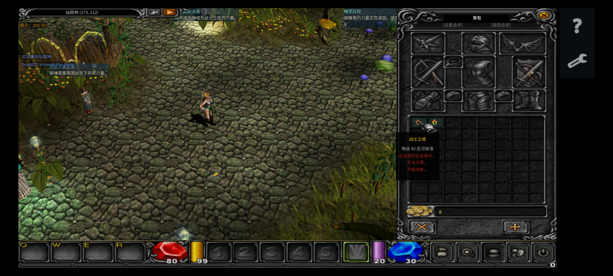
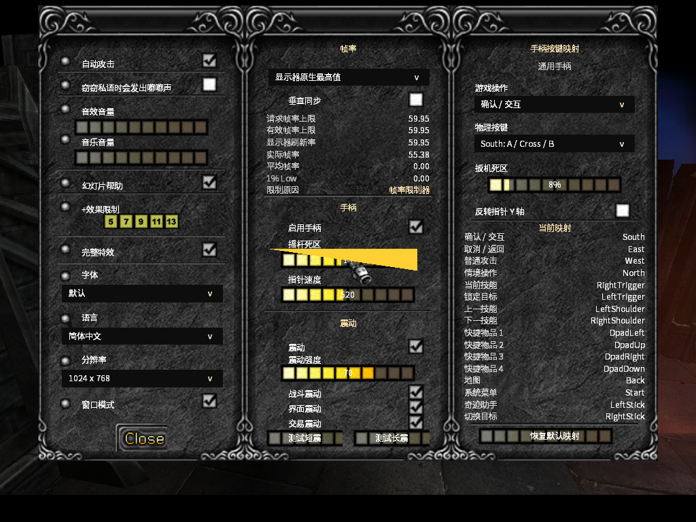
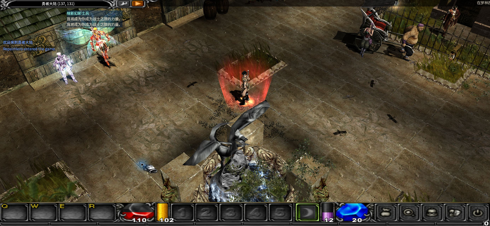
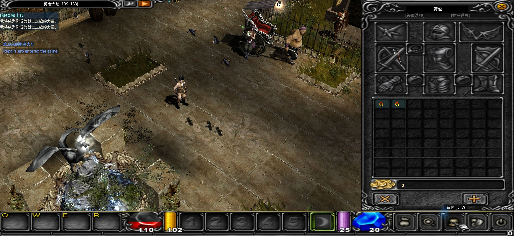

# OpenMU (Open Multi-Platform Universe)

**现代化跨设备 3D 虚拟世界引擎与分布式客户端-服务端生态**

[简体中文](README.zh-CN.md) · [English](README.md)

面向经典等轴角虚拟世界架构的高性能系统重构、统一输入抽象与六端原生移植：Windows · Android · HarmonyOS · iOS · macOS · Linux。


*原生六端移植展示：Android / 纯血鸿蒙移动端原生运行，集成双分区触控手势 HUD、技能轮换与全面屏安全区自适应。*

[](LICENSE)
[](https://github.com/MUnique/OpenMU)
[](https://github.com/sven-n/MuMain)
[](#支持平台与跨设备移植特性)
[](#统一输入抽象层手柄与触控优先设计)
[](#系统技术架构)
[](#系统技术架构)
[-d69e2e?style=flat-square)](#全链路国际化支持)
[](#质量保证与自动化测试体系)

---

## 项目背景与开源初衷

2000年代初期的经典等轴角 MMORPG 架构受限于历史技术条件，通常存在严重的遗留系统包袱：单线程 Win32 消息循环、仅支持 ANSI 单字节编码、固定管线 OpenGL 1.1 渲染、锁死 4:3 分辨率，且与桌面键鼠环境高度耦合，无法跨平台，更难以直接适配现代移动终端与掌机设备。

**OpenMU Engine** 致力于以现代系统级工程思维全面重构并留存该类复杂客户端-服务端系统：
- **现代 Core Profile 渲染管线**：全面升级至 **OpenGL 3.3 Core Profile**（针对移动端接入 GLES / gl4es），彻底淘汰过时的固定渲染管线，引入环形缓冲区 UBO 流式传输与几何合批。
- **统一硬件无关输入抽象**：自主研发跨设备输入系统，深度支持现代主流游戏手柄、移动端多指触控手势及键鼠操控。
- **.NET 10 Native AOT 高性能网络栈**：客户端网络通信核心模块采用 **.NET 10 Native AOT** 原生编译为 ARM64 与 x86_64 机器码，消除高频网络交互中的 GC 抖动与延迟。
- **全链路 Unicode 架构**：内部内存处理全面统一为 UTF-16LE，网络与文件边界采用 UTF-8 序列化，原生支持 15 种语言动态无损切换。
- **真正的原生六端移植**：摒弃 Web 嵌套与低效模拟器，实现覆盖主流桌面、移动端及国产操作系统的全原生编译。

---

## 核心特性

### 支持平台与跨设备移植特性

本项目实现了一套代码在六大操作系统平台上的原生编译与稳定运行：

| 平台 | 目标指令集 | 构建系统与技术方案 | 移植状态 |
| :--- | :--- | :--- | :--- |
| **Windows** | x86 / x64 | CMake + Ninja，MSBuild 预设，集成 Clang-Tidy 与 ASan (AddressSanitizer) | 生产就绪 (Production Ready) |
| **Android** | ARM64 (`aarch64`) | Android NDK + CMake 原生编译，gl4es/GLES 硬件加速，Native AOT arm64 运行时，Gradle 自动化构建流水线 | 生产就绪 (Production Ready) |
| **HarmonyOS** | ARM64 (`aarch64`) | OpenHarmony / 纯血鸿蒙原生 hvigor 模块 (`harmony-game`, `harmony-gm`, `harmony-pc`)，集成 `nativeaot-ohos` 原生栈 | 生产就绪 (Production Ready) |
| **iOS** | ARM64 (`arm64`) | Xcode / CMake 原生构建目标 (`game-ios`)，集成 iOS Native AOT 客户端库运行时 (`nativeaot-ios`) | 成功移植 / 稳定运行 |
| **macOS** | Universal (`arm64` + `x86_64`) | CMake 原生集成 Objective-C++ 桥接，完整支持 Apple Silicon 与 Intel 架构通用二进制构建 | 成功移植 / 稳定运行 |
| **Linux** | x64 / ARM64 | MinGW-w64 交叉编译链，原生 GCC/Clang 支持，具备无界面分布式服务端集群部署能力 | 成功移植 / 稳定运行 |

---

### 统一输入抽象层：手柄与触控优先设计

引擎内建了高内聚的输入抽象调度层（`GamepadService`、`SdlGamepadBackend`、`GamepadMapper`、`GamepadBindings` 与 `FocusNavigator`），确保在不同人机交互界面下拥有一致的操作体验。

#### 1. 主机级手柄引擎
- **全硬件支持**：支持按键全动态重映射、配置本地持久化及一键重置。
- **摇杆精确标定**：支持摇杆硬件死区微调、平滑动态指针加速度曲线与 Y 轴反转设定。
- **五通道沉浸式震动反馈**：独立细分战斗受击、UI 操作、交易交互等多路触觉反馈，支持震动强度即时微调与自检测试。
- **图形化焦点导航器 (Focus Navigator)**：基于拓扑图的 UI 焦点遍历算法，支持纯手柄方向键与摇杆顺畅操作复杂的背包、对话树与角色面板。
- **虚拟屏幕键盘**：针对纯手柄与掌机使用场景，内建手柄驱动的虚拟文字输入界面。


*手柄设置界面：动态按键绑定、摇杆死区标定、指针加速度与多通道触觉震动调试*

#### 2. 原生移动端多指触控手势
Android 与鸿蒙端并非简单的鼠标指针模拟，而是专门研发的原生手势引擎：
- **双分区交互**：屏幕左半区平滑拖拽移动，右半区点按拾取、锁定与交互。
- **连招与技能切换**：技能区双击即时施放，双指水平滑动无缝循环轮换技能栏。
- **视角与宏观导航**：双指捏合缩放镜头视野，双指垂直拖动调节俯仰角，三指上滑开启地图，三指向下滑动快速唤出设置菜单。
- **人体工学无障碍**：内建完整左手模式（翻转控制分区与功能侧边栏，同时保持场景投影视角坐标不畸变），支持异形全面屏/刘海屏安全区自适应与界面透明度自由缩放。


*移动端界面：双区触控 HUD、人体工学侧边工具栏与触控自适应物品提示*

---

### 现代渲染管线与低层系统级优化

- **Core Profile 现代 OpenGL 渲染**：彻底移除废弃的 Immediate Mode (`glBegin`/`glEnd`) 和 Display Lists，改用环形缓冲区 UBO (Uniform Buffer Object) 进行高吞吐流式传输，杜绝 CPU-GPU 管线阻塞。
- **纹理状态几何分桶合批**：依据纹理渲染状态对地形与建筑网格实施动态归类合批，**将地形 Draw Call 减少约 25 倍**。
- **GPU 骨骼动画蒙皮**：将复杂的骨骼动画蒙皮矩阵计算移交顶点着色器执行，配合 SIMD 指令集加速。
- **多线程动画任务池**：多核并发驱动同屏密集实体的骨骼动画计算更新。
- **真机性能实测提升**：
  - **平均帧率 (Average FPS)**：提升 `+4.4%`
  - **1% Low 极端掉帧率**：改善 `+28.0%`
  - **帧生成耗时方差**：下降 `−4.1%`

---

### 确定性数值平衡与模拟验证实验室

位于 `OpenMU-数值重设计/`，包含完整的自主研发数值推演实验室 (`BalanceLab`)：
- **全连续浮点数公式**：废除粗糙的整除截断，对攻击速度、命中率（$[0.05, 0.95]$ 边界约束）及状态增益实施全连续平滑曲线重构。
- **双曲护甲减伤模型**：引入现代双曲减伤方程 ($Damage = Raw \times \frac{K}{Armor + K}$)，彻底消除旧版防御力悬崖断层。
- **高精度经济体系**：采用 4 位小数精度掉落分布矩阵，全面升级 64 位防溢出资产计算体系。
- **角色成长收敛性验证**：基于蒙特卡洛随机模拟，验证覆盖全部 14 种职业衍生流派，确保通关成长耗时严格收敛在 $\pm 10\%$ 目标方差区间内。

---

### 全链路国际化支持

- **架构标准**：内部统一采用 UTF-16LE 宽字符宽指针，边界交互采用 UTF-8 紧凑编码，彻底告别旧时代的 ANSI Code Page 乱码瓶颈。
- **自动化工作流**：支持 `.resx` 标准资源文件自动生成强类型 C++ 访问类，配合运行时观察者模式实现无缝动态语言热切换。
- **15 种本地化语言**：涵盖英语、简体中文、繁体中文、日语、韩语、德语、西班牙语、法语、葡萄牙语、俄语、乌克兰语、波兰语、印尼语、越南语与菲律宾语。

---

## 多端运行展示

| 实时三维世界渲染 (桌面端) | 原生多指手势 HUD (移动端) |
| :---: | :---: |
|  |  |
| *2.5D/3D 等轴角实时光影渲染与动态投影* | *双分区触控交互、技能栏轮换与全面屏安全区自适应* |
| **主机级手柄标定系统** | **模块化背包与装备引擎** |
|  |  |
| *五通道触觉震动微调、摇杆死区标定与焦点遍历* | *服务端原子校验的网格化背包与装备状态机* |

---

## 系统技术架构

```
┌────────────────────────────────────────────────────────────────────────┐
│  客户端应用层 (Client Application Tier)                               │
│    MuMain 引擎核心      C++20 · SDL3 · OpenGL 3.3 Core Profile         │
│    移动端原生应用壳     Android (NDK/Gradle) · HarmonyOS · iOS · macOS │
├────────────────────────────────────────────────────────────────────────┤
│  统一跨平台抽象层 (Unified Abstraction Layer)                          │
│    统一输入核心         GamepadService · FocusNavigator · TouchEngine  │
│    国际化文本引擎       UTF-16LE 原生编码 · 动态 15 国语言无缝热重载     │
├────────────────────────────────────────────────────────────────────────┤
│  高性能网络与序列化层 (Network & Serialization Tier)                    │
│    原生执行时运行时     C# / .NET 10 Native AOT 客户端库 (arm64 零 GC)  │
│    通信协议引擎         零内存分配二进制封包序列化与加密通道           │
├────────────────────────────────────────────────────────────────────────┤
│  分布式服务端引擎 (Distributed Server Engine)                          │
│    GameLogic 游戏逻辑   状态同步分发 · 移动与技能反作弊校验引擎        │
│    数值模拟实验室       BalanceLab · 双曲减伤模型 · 浮点高精度掉落     │
│    数据持久化层         PostgreSQL 高并发数据库存储与事务隔离引擎      │
└────────────────────────────────────────────────────────────────────────┘
```

---

## 仓库目录结构

```
├── MuMain/                 # 高性能 C++20 客户端引擎 (SDL3, OpenGL 3.3, 统一输入调度层)
├── OpenMU/                 # 分布式 .NET 10 游戏服务端、高并发网络协议栈与 Web 管理后台
├── OpenMU-Android/         # Android ARM64 原生应用工程、NDK 构建系统与 Gradle 流水线
├── OpenMU-HarmonyOS/       # 纯血鸿蒙 OpenHarmony / HarmonyOS 原生 hvigor 模块与构建脚本
├── OpenMU-iOS/             # iOS 原生工程与 Native AOT 移动构建集成
├── OpenMU-数值重设计/       # BalanceLab 数值推演实验室：确定性仿真、数学方程与平衡数据
├── tests/                  # 4-Tier 自动化端到端测试、对抗性压力测试与回归验证套件
├── loc/                    # 国际化本地化定义文件 (.resx) 及自动化 C++ 代码生成工具
└── assets/                 # 架构图、技术展示截图与相关静态媒介资源
```

---

## 质量保证与自动化测试体系

本仓库实施严格的工程质量自检标准与双轨自动化验证流程：
- **Tier 1-4 端到端功能与回归测试套件** (`tests/e2e/`)：包含 36+ 组自动化测试，全量覆盖客户端二进制网络派发、服务端防作弊移动校验、技能命中边界拦截、交易防重扣事务保护、多线程资源生命周期管理等。
- **对抗性压力验证引擎** (`tests/adversarial/`)：自动化多轮对抗性推演测试，深度验证全场景战斗数值方程连续性、极端经济边界防溢出及底层内存安全性。
- **服务端 xUnit 单元测试套件** (`OpenMU/tests/`)：深度覆盖服务端状态机、网络分包器与数据库持久化流水线。

运行本地自动化验证：
```powershell
python -m unittest discover -s tests/e2e/tier1_features -p "test_*.py"
```

### 智能化维护与开源工程实践
为以独立维护者精力持续支撑覆盖 6 大平台的跨设备原生系统工程，本项目在架构上深度拥抱测试自动化与现代 AI 辅助研发工作流（如 OpenAI Codex / ChatGPT Pro）：
- **全自动化回归分析**：420+ 项自动化端到端与单元测试用例，持续守护协议序列化、实体状态机、防作弊不变式及多线程生命周期。
- **智能化代码诊断与重构**：清晰的架构分层与显式类型约束，便于借助大语言模型与智能编程助手进行多平台交叉编译报错诊断、边缘用例生成与内存安全审计。
- **严格干净室开源设计**：协议抽象与分布式状态机均为独立干净室设计实现，专注于开源系统工程研究，完全零商业专有依赖。

---

## 源码编译说明

### 环境准备
- **客户端**：CMake 3.25+、支持 C++20 的现代编译器（MSVC 2022、Clang 16+ 或 GCC 13+）以及 .NET 10 SDK（用于 Native AOT 客户端通信库）。
- **服务端**：.NET 10 SDK 以及 PostgreSQL 14+ 数据库环境。

### 客户端构建 (Windows x64)
```powershell
cmake --preset windows-x64
cmake --build --preset windows-x64-release
```

### 服务端构建 (.NET 10)
```bash
dotnet build OpenMU/src/MUnique.OpenMU.sln -c Release
```

更多平台的详细构建步骤请参阅各平台专属文档：
- 桌面端客户端构建：[`MuMain/docs/build/`](MuMain/docs/build/)
- 服务端快速上手配置：[`OpenMU/QuickStart.md`](OpenMU/QuickStart.md)
- Android 打包流水线：[`OpenMU-Android/Build-AndroidPackage.ps1`](OpenMU-Android/Build-AndroidPackage.ps1)

---

## 开源许可与上游项目致谢

本项目属于面向跨平台图形引擎架构、分布式虚拟世界系统以及经典网络交互协议的开源技术研究与软件数字化留存项目。衷心感谢开源社区先驱项目的贡献与奠基：

### 上游开源项目
- **分布式服务端核心**：**[MUnique/OpenMU](https://github.com/MUnique/OpenMU)** — 基于 C# / .NET 10 的现代化分布式游戏服务端架构、高并发网络协议栈与 Web 运维管理套件，遵循 **[MIT 许可证](https://github.com/MUnique/OpenMU/blob/master/LICENSE)**（Copyright © 2017 MUnique）。
- **客户端系统底座**：**[sven-n/MuMain](https://github.com/sven-n/MuMain)** — 开源 C++ 客户端系统研究底座，为早期 Core Profile OpenGL 现代渲染管线、帧率平滑调度及本地化框架提供了重要的工程参考。

### 第三方开源组件
本项目所引用的第三方库均保留其原有开源许可证：
- **SDL3** (zlib License) — 跨平台窗口抽象与事件调度
- **OpenGL / gl4es** (MIT License) — Core Profile 与移动端硬件加速
- **Dear ImGui** (MIT License) — 引擎内置诊断与参数微调
- **libcurl** (curl License) — 网络数据传输
- **librime** (BSD-3-Clause) — 游戏内多语言输入法
- **libjpeg-turbo** (IJG / BSD-3-Clause) — 高吞吐图像解码

### 免责声明与合规说明
本代码仓库仅包含完全干净室实现的开源引擎与服务端源码，发布目的严格限于计算机系统结构学术研究、跨设备人机交互探索与开源数字化保护。代码中提及的任何网络协议名词或兼容性术语，仅作为协议互操作性工程研究参考。本仓库不包含、不分发任何非开源商业游戏资源、专有素材或私有网络密钥。相关商标与产品名称所有权归其各自原厂商所有。
